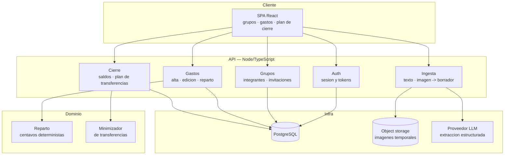
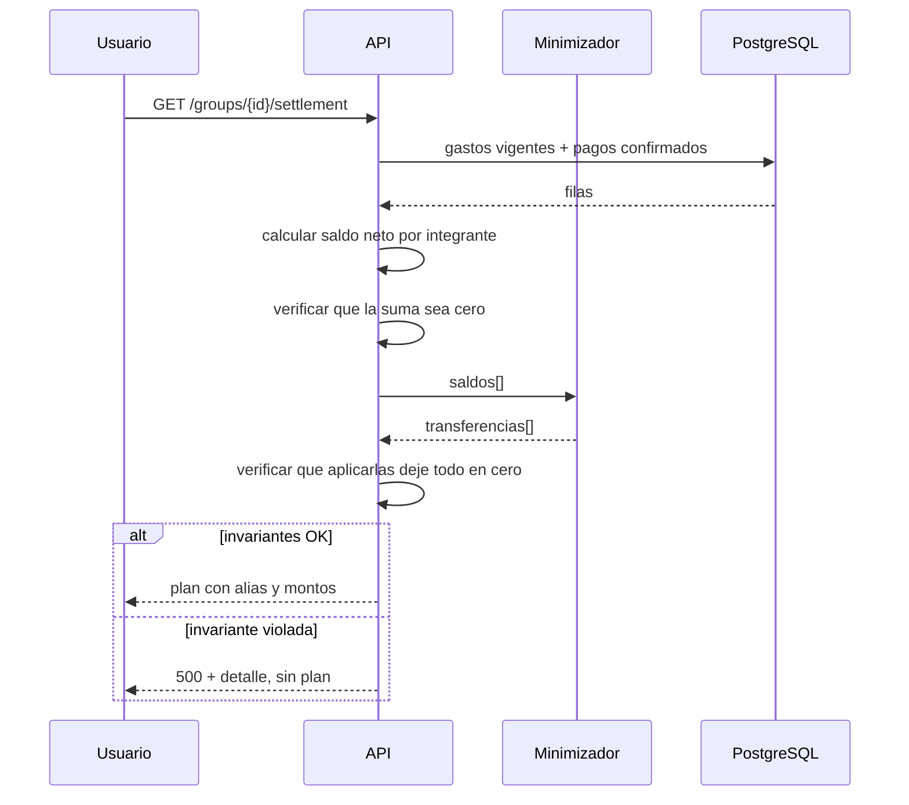
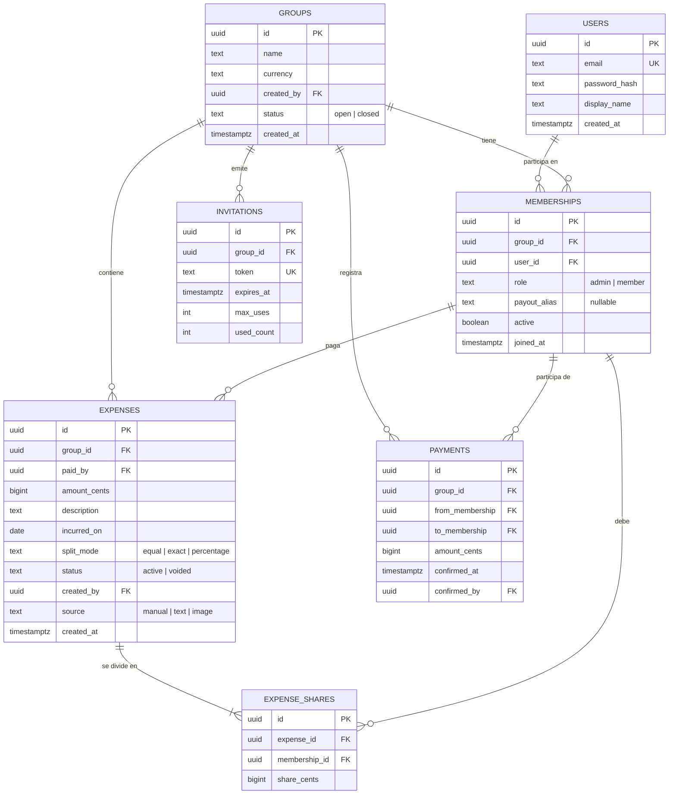

# Vaquita

> Hacer una vaquita entre amigos es facil. Cerrarla no.

## Indice

0. [Ficha del proyecto](#0-ficha-del-proyecto)
1. [El problema](#1-el-problema)
2. [Que hace el usuario y que le devuelve el sistema](#2-que-hace-el-usuario-y-que-le-devuelve-el-sistema)
3. [El desafio tecnico interesante](#3-el-desafio-tecnico-interesante)
4. [Funcionalidades del MVP (historias de usuario)](#4-funcionalidades-del-mvp-historias-de-usuario)
5. [Arquitectura](#5-arquitectura)
6. [Modelo de datos](#6-modelo-de-datos)
7. [Especificacion de la API](#7-especificacion-de-la-api)
8. [Decisiones de alcance y riesgo](#8-decisiones-de-alcance-y-riesgo)
9. [Stack tecnico](#9-stack-tecnico)
10. [Tickets de trabajo](#10-tickets-de-trabajo)
11. [Como correr el proyecto](#11-como-correr-el-proyecto)

<details>
<summary>Equivalencia con la plantilla oficial del curso</summary>

Este documento usa una numeracion propia porque el orden sigue el razonamiento
del proyecto. La correspondencia con la plantilla `AI4Devs-finalproject` es:

| Plantilla oficial | Aqui |
|---|---|
| 0. Ficha del proyecto | 0 |
| 1.1 Objetivo | 1 |
| 1.2 Caracteristicas y funcionalidades | 2 y 4 |
| 1.3 Diseño y experiencia de usuario | 2.1 |
| 1.4 Instrucciones de instalacion | 11 |
| 2.1 Diagrama de arquitectura | 5.1 |
| 2.2 Descripcion de componentes | 5.1 y 5.2 |
| 2.3 Estructura de ficheros | 5.4 |
| 2.4 Infraestructura y despliegue | 5.5 |
| 2.5 Seguridad | 5.6 |
| 2.6 Tests | 5.7 |
| 3. Modelo de datos | 6 |
| 4. Especificacion de la API | 7 |
| 5. Historias de usuario | 4 |
| 6. Tickets de trabajo | 10 |
| 7. Pull requests | no aplica — ver nota |

**Sobre la seccion 7 de la plantilla (Pull Requests):** la Leccion 1 del Proyecto
Final, que se declara fuente de verdad de las reglas, dice que la entrega es rama
+ Typeform y que no hay que abrir ningun Pull Request. Por eso este documento no
tiene esa seccion.

</details>

---

## 0. Ficha del proyecto

| | |
|---|---|
| **0.1 Nombre completo del alumno** | Lisandro Arguello |
| **0.2 Nombre del proyecto** | Vaquita |
| **0.3 Descripcion breve** | Gastos compartidos entre grupos chicos. Dado el saldo neto de cada integrante, calcula el conjunto minimo de transferencias que deja a todos en cero. No mueve dinero: emite instrucciones de pago. |
| **0.4 URL del proyecto** | Todavia no desplegado. El despliegue es opcional segun las reglas del curso; se decide en la Entrega 3. |
| **0.5 URL del repositorio** | https://github.com/lisandroarguello/vaquita — publico |
| **Programa** | LIDR AI4Devs — cohorte 2026/08 |
| **Entrega** | 1 — Documentacion tecnica |
| **Rama de esta entrega** | `feature/entrega-1-la` |
| **Dominio** | Fintech / gastos compartidos |

---

## 1. El problema

Un grupo de seis personas se va cinco dias a la costa. Uno pone el alquiler, otra
la nafta, otro el super del primer dia, alguien mas paga tres cenas con la tarjeta
y despues hay dos transferencias sueltas "a cuenta" que nadie anota.

Al volver, alguien abre una planilla. Esa planilla tiene tres problemas:

1. **Cargar los gastos es tedioso.** Cada gasto es un mensaje de WhatsApp, una foto
   de un ticket o una notificacion del banco. Transcribirlos a mano es el motivo
   real por el que la planilla queda a medias.
2. **Las divisiones no son iguales.** El alquiler se divide entre seis, pero la
   cena del jueves fueron cuatro, y la nafta la pagan solo los que viajaron en auto.
3. **El cierre genera mas transferencias de las necesarias.** Seis personas con
   saldos cruzados producen, hechas una por una, hasta quince transferencias.
   El minimo real casi siempre son tres o cuatro.

El tercer punto es el que hace que la vaquita no se cierre nunca. No es un problema
de contabilidad: es un problema de friccion. Cada transferencia es un alias que
alguien tiene que pedir, copiar y pegar.

### A quien le sirve

Grupos chicos y temporales que comparten gastos sin una relacion contable formal:
viajes, alquileres compartidos, asados recurrentes, regalos grupales. Entre 3 y 15
personas. En Argentina y la region, donde el instrumento de cierre es la
transferencia por alias o CVU, no un pago intragrupal dentro de una app.

### Que NO es

Vaquita **no mueve dinero**. No es un PSP, no tiene cuenta de dinero electronico,
no toma custodia de fondos. Emite instrucciones de pago — "Ana le transfiere
$18.400 a Javier, alias `javier.mp`" — y registra cuando alguien las marca como
hechas. Esa decision es deliberada y esta justificada en la seccion 8.

---

## 2. Que hace el usuario y que le devuelve el sistema

**El usuario crea un grupo y carga gastos de tres maneras:**

- Escribiendo el gasto a mano (monto, descripcion, quien pago, entre quienes se divide).
- **Pegando texto crudo**: el mensaje del banco, el detalle de la factura, lo que
  le mandaron por WhatsApp. Un LLM extrae monto, comercio, fecha y moneda, y
  propone a quien corresponde dividirlo segun el historial del grupo.
- **Subiendo la foto de un ticket**: misma extraccion, sobre la imagen.

**El sistema le devuelve, en todo momento:**

- El saldo neto de cada integrante: cuanto puso de mas o de menos.
- **El plan de cierre**: la lista minima de transferencias que deja a todos en cero,
  cada una con el alias de destino listo para copiar.
- El historial auditable de cada gasto, con quien lo cargo y como se dividio.

**El momento que define el producto** es el boton *Cerrar la vaquita*: cinco dias
de gastos cruzados se convierten en tres transferencias concretas, con alias y monto.

---

### 2.1 Diseño y experiencia de usuario

> Plantilla oficial 1.3. La Leccion 1 pide imagenes o video de la experiencia
> para la Entrega Final. En la Entrega 1 no hay interfaz todavia, asi que lo que
> sigue es el recorrido comprometido; las capturas se agregan en la Entrega 3.

El recorrido completo son cuatro pantallas, ni una mas:

1. **Grupo.** Lista de integrantes y total gastado. Es la pantalla de inicio.
2. **Alta de gasto.** Quien pago, cuanto, y como se reparte. El reparto por
   partes iguales viene elegido; las divisiones flexibles estan a un toque.
3. **Saldos.** Cuanto debe o le deben a cada uno, en tiempo real. Sin accion.
4. **Cierre.** La pantalla que define el producto: la lista minima de
   transferencias, cada una con alias de destino y monto, y el contador de
   cuantas transferencias se ahorraron frente a que cada deudor le pague a cada
   acreedor.

La decision de experiencia que ordena todo el resto: **cargar un gasto tiene que
costar menos que no cargarlo.** Si cargar es friccion, el grupo abandona a los
tres dias y el cierre no tiene datos que cerrar. De ahi que exista la ingesta
desde texto o foto (HU-3) y que el camino manual tenga los valores por defecto
puestos donde cae el caso comun.

---

## 3. El desafio tecnico interesante

Este no es un CRUD con un formulario de gastos. Hay dos nucleos no triviales.

### 3.1 Minimizacion de transferencias

Dado el saldo neto de cada integrante, hay que encontrar el conjunto **mas chico**
de transferencias que lleva a todos a cero.

Formalmente es una variante del problema de *cash flow minimization*, y el caso
general es NP-duro (se reduce a particion de conjuntos). Pero el tamaño real del
problema es chico — grupos de hasta 15 personas — asi que la estrategia es:

1. **Exacto para n <= 12**: busqueda de subconjuntos que suman cero, resueltos
   independientemente. Cada grupo de k personas que suma cero se cierra con k-1
   transferencias, y la union de esos grupos es optima.
2. **Greedy para n > 12**: emparejar iterativamente el mayor acreedor con el mayor
   deudor. Garantiza a lo sumo n-1 transferencias — nunca peor que el naive, que
   puede dar hasta n(n-1)/2.

El algoritmo se implementa **puro, sin acceso a base de datos**, recibiendo un
vector de saldos y devolviendo un vector de transferencias. Eso lo hace trivial
de testear y es donde va a concentrarse la bateria de tests unitarios.

**Invariante que se verifica en cada ejecucion**: la suma de los saldos de entrada
es cero (con tolerancia de redondeo), y aplicar las transferencias propuestas deja
todos los saldos en cero. Si no se cumple, el sistema no muestra un plan: muestra
un error. Un plan de cierre equivocado es peor que ningun plan.

### 3.2 Aritmetica de dinero y el centavo que sobra

$100 entre 3 personas no son tres pagos de $33,33. Son $33,34 + $33,33 + $33,33.
Ese centavo tiene que ir a algun lado, y tiene que ir **siempre al mismo lado** o
los saldos no cierran.

Decisiones:

- Todo monto se almacena como **entero en centavos** (`BIGINT`). Nunca punto flotante.
- El reparto de un gasto distribuye el resto de la division entera de forma
  determinista: los primeros `resto` participantes, ordenados por su id, reciben
  un centavo extra.
- **Invariante**: la suma de las partes de un gasto es exactamente igual al monto
  del gasto. Se verifica en el dominio, antes de persistir.

### 3.3 La extraccion con LLM puede fallar, y eso es parte del diseño

Un LLM leyendo un ticket arrugado se equivoca. El diseño lo asume:

- La extraccion **nunca persiste directamente** un gasto. Devuelve un borrador.
- Cada campo del borrador viene con un nivel de confianza, y los de confianza baja
  se marcan en la UI para que el usuario los confirme.
- El usuario siempre ve y edita el borrador antes de guardarlo.
- Si el LLM no esta disponible o devuelve algo que no valida contra el esquema, la
  carga manual sigue funcionando. **La funcionalidad nucleo no depende del LLM.**

---

## 4. Funcionalidades del MVP (historias de usuario)

Cinco historias. Son el alcance completo de la version 1.

---

### HU-1 — Crear un grupo e invitar integrantes

> **Como** organizador de un viaje
> **quiero** crear un grupo y sumar a los que van
> **para** tener un lugar unico donde se anotan los gastos.

**Reglas de negocio**

- Un grupo tiene nombre, moneda unica y un creador, que queda como administrador.
- Se invita por enlace con token. El invitado se suma con nombre y, opcionalmente, alias de cobro.
- Un grupo admite entre 2 y 15 integrantes.
- No se puede eliminar a un integrante que participa de algun gasto. Se lo puede marcar como inactivo.

**Criterios de aceptacion**

1. Dado que estoy autenticado, cuando creo un grupo con nombre y moneda, entonces quedo como administrador y veo el grupo vacio.
2. Dado un grupo del que soy administrador, cuando genero un enlace de invitacion, entonces obtengo una URL con token valido por 7 dias.
3. Dado un enlace de invitacion valido, cuando lo abro estando autenticado, entonces quedo sumado al grupo y veo su historial completo.
4. Dado un enlace vencido o ya usado el maximo de veces, cuando lo abro, entonces veo un mensaje que lo explica y no quedo sumado.
5. Dado un grupo con 15 integrantes, cuando intento sumar uno mas, entonces el sistema lo rechaza indicando el limite.

---

### HU-2 — Cargar un gasto a mano con division flexible

> **Como** integrante del grupo
> **quiero** cargar un gasto eligiendo quien lo pago y entre quienes se divide
> **para** que el saldo refleje lo que realmente paso.

**Reglas de negocio**

- Un gasto tiene monto, descripcion, fecha, un pagador y al menos un participante.
- Tres modos de division: **partes iguales**, **montos exactos** y **porcentajes**.
- En montos exactos, la suma debe ser igual al total del gasto. En porcentajes, debe sumar 100%.
- En partes iguales, el resto de la division se asigna de forma determinista por orden de id.
- El pagador no necesariamente participa del gasto (puede pagar algo de lo que no consume).
- Un gasto puede editarse o anularse; queda registro de quien lo hizo y cuando.

**Criterios de aceptacion**

1. Dado un grupo de 3, cuando cargo $100 en partes iguales, entonces las partes son $33,34 / $33,33 / $33,33 y suman exactamente $100.
2. Dado el modo montos exactos, cuando la suma de las partes no coincide con el total, entonces el sistema rechaza el gasto indicando la diferencia.
3. Dado el modo porcentajes, cuando los porcentajes no suman 100, entonces el sistema lo rechaza indicando el faltante o sobrante.
4. Dado un gasto cargado, cuando lo edito, entonces los saldos del grupo se recalculan y el cambio queda en el historial.
5. Dado un gasto anulado, cuando consulto los saldos, entonces ese gasto no influye, pero sigue visible en el historial marcado como anulado.

---

### HU-3 — Cargar un gasto desde texto o desde la foto de un ticket

> **Como** integrante que acaba de pagar algo
> **quiero** pegar el mensaje del banco o sacarle una foto al ticket
> **para** no transcribir montos a mano.

**Reglas de negocio**

- La extraccion devuelve un **borrador**, nunca un gasto persistido.
- El borrador trae: monto, moneda, fecha, descripcion y una propuesta de participantes.
- Cada campo lleva un nivel de confianza: `alta`, `media`, `baja`.
- Los campos de confianza `baja` se resaltan en la UI y requieren confirmacion explicita.
- La propuesta de participantes sale del historial: a quienes se les suele dividir ese tipo de gasto en ese grupo.
- Si el modelo no responde, responde fuera del esquema o tarda mas de 15 segundos, el sistema lo informa y ofrece la carga manual con lo que haya podido extraer.
- Las imagenes se guardan solo mientras el borrador esta abierto; al confirmarlo o descartarlo, se eliminan.

**Criterios de aceptacion**

1. Dado el texto "Compraste $45.300,00 en COTO - 12/11", cuando lo pego, entonces el borrador muestra monto $45.300,00, fecha 12/11 y descripcion "COTO".
2. Dada la foto de un ticket legible, cuando la subo, entonces obtengo un borrador con el total y la fecha.
3. Dado un borrador con el monto en confianza `baja`, cuando lo abro, entonces ese campo aparece resaltado y no puedo guardar sin confirmarlo.
4. Dado que el servicio de extraccion no responde, cuando subo un ticket, entonces veo un aviso claro y el formulario manual vacio y utilizable.
5. Dado un borrador, cuando lo descarto, entonces la imagen asociada se elimina y no queda ningun gasto creado.

---

### HU-4 — Ver el saldo de cada integrante en tiempo real

> **Como** integrante del grupo
> **quiero** ver cuanto puse de mas o de menos
> **para** saber en que situacion estoy sin tener que hacer cuentas.

**Reglas de negocio**

- El saldo de un integrante es: lo que pago menos lo que le corresponde pagar.
- Positivo significa que le deben; negativo, que debe.
- La suma de todos los saldos de un grupo es siempre exactamente cero.
- Los saldos se calculan a partir de los gastos vigentes y de los pagos ya marcados como hechos.

**Criterios de aceptacion**

1. Dado un grupo con gastos cargados, cuando entro al grupo, entonces veo la lista de integrantes con su saldo y un indicador visual de signo.
2. Dado cualquier estado del grupo, cuando sumo todos los saldos, entonces el resultado es exactamente cero.
3. Dado un grupo sin gastos, cuando lo abro, entonces todos los saldos son cero y veo una invitacion a cargar el primer gasto.
4. Dado que otro integrante carga un gasto, cuando recargo la vista, entonces mi saldo refleja el gasto nuevo.

---

### HU-5 — Cerrar la vaquita con el minimo de transferencias

> **Como** organizador
> **quiero** que el sistema me diga exactamente quien le transfiere a quien y cuanto
> **para** cerrar el grupo con la menor cantidad de movimientos posible.

**Reglas de negocio**

- El plan se calcula sobre los saldos vigentes y propone el conjunto minimo de transferencias.
- Cada transferencia muestra origen, destino, monto y el alias de cobro del destinatario.
- El plan es una **propuesta**: Vaquita no ejecuta ni intermedia ningun pago.
- Cada transferencia se marca como hecha manualmente, por el que paga o por el que cobra.
- Al marcar una transferencia, los saldos se actualizan y el plan se recalcula.
- Un grupo queda cerrado cuando todos los saldos son cero. Un grupo cerrado se puede reabrir si aparece un gasto tardio.
- El plan nunca se muestra si la verificacion de invariantes falla; en ese caso se muestra un error y el detalle.

**Criterios de aceptacion**

1. Dado un grupo con saldos +$100 / -$60 / -$40, cuando pido el plan, entonces obtengo exactamente 2 transferencias.
2. Dado un grupo con saldos +$50 / -$50 / +$30 / -$30, cuando pido el plan, entonces obtengo exactamente 2 transferencias, no 3.
3. Dado un plan calculado, cuando marco una transferencia como hecha, entonces los saldos involucrados se actualizan y el plan se recalcula sin esa transferencia.
4. Dado un grupo con todos los saldos en cero, cuando lo abro, entonces veo el estado "cerrado" y ninguna transferencia pendiente.
5. Dado un plan calculado, cuando se aplican todas sus transferencias, entonces todos los saldos quedan exactamente en cero.
6. Dado un destinatario sin alias cargado, cuando aparece en el plan, entonces la transferencia se muestra igual con un aviso de que falta el alias.

---

## 5. Arquitectura

### 5.1 Vista general



### 5.2 Por que asi

**Monolito modular, no microservicios.** El proyecto tiene un solo desarrollador y
tres semanas. Los modulos estan separados por carpeta y por interfaz, no por red.
Si alguna vez hiciera falta extraer la ingesta a su propio servicio — es lo unico
que tiene un perfil de latencia distinto — la frontera ya esta dibujada.

**El dominio no conoce la base de datos.** `Reparto` y `Minimizador` son funciones
puras: entran numeros, salen numeros. Esto no es purismo arquitectonico, es la
decision que hace que la parte riesgosa del sistema sea testeable sin levantar nada.
Es tambien donde va la mayor densidad de tests.

**La ingesta es un modulo con una frontera dura.** Recibe texto o imagen, devuelve
un borrador validado contra un esquema. El resto del sistema no sabe que existe un
LLM. Si mañana se reemplaza por OCR, por otro proveedor o por nada, cambia un modulo.

**Los saldos se calculan, no se almacenan.** Un saldo materializado es una fuente
de verdad duplicada que se desincroniza. Con grupos de hasta 15 personas y gastos
en el orden de las centenas, calcularlos en cada lectura es barato. Si el perfilado
mostrara que no lo es, se agrega una vista materializada — pero recien despues de
medirlo.

### 5.3 Flujo del caso que define el producto



---

### 5.4 Estructura de ficheros

> Plantilla oficial 2.3. Estructura comprometida. Al cierre de la Entrega 2
> existen `app/domain/`, `database/migrations/` y `tests/` (unitarios del
> dominio y de esquema contra Postgres); el resto —modelos, validadores,
> `ingest/` y el frontend— sigue siendo estructura comprometida y no escrita.

```
vaquita/
├─ backend/                   AdonisJS 6.18
│  ├─ app/
│  │  ├─ controllers/         Orquestan la peticion: reciben, delegan, responden
│  │  ├─ models/              Lucid. La fila en la base de datos
│  │  ├─ validators/          VineJS. Forma de los datos de entrada
│  │  ├─ transformers/        Que se devuelve al cliente y que no
│  │  └─ domain/              Reparto y Minimizador. Funciones puras
│  ├─ database/
│  │  ├─ migrations/          Cambios de esquema versionados
│  │  └─ seeders/             Datos de prueba generados, nunca reales
│  ├─ ingest/                 Texto/imagen -> borrador validado (Zod)
│  ├─ start/routes.ts         Que URL responde a que accion
│  └─ tests/                  Japa: integracion y E2E
└─ frontend/                  React 19 + Vite
   ├─ src/components/ui/      shadcn/ui, copiado al repo
   └─ src/pages/              Las cuatro pantallas de 2.1
```

La convencion de carpetas es la de AdonisJS, salvo por `app/domain/`, que no es
una capa del framework.

**Sobre la version:** el prework del Modulo 1 menciona AdonisJS 7, pero el
starter kit oficial (`adonisjs/api-starter-kit`, rama `main`) instala
`@adonisjs/core` 6.18, que es lo que corre este proyecto. En npm la version
`latest` ya es 7.6. Se deja en 6.18 a proposito: es la que el starter kit da por
buena, y migrar de major no aporta nada al producto. Queda anotado por si el
material del curso asume APIs de la 7.

El limite que importa es `app/domain/`: no importa nada de `controllers/`, de
`models/` ni del framework. Esa regla es lo que hace que la parte riesgosa del
sistema se pueda testear sin levantar infraestructura, y es la unica que vale la
pena hacer cumplir con un chequeo automatico.

### 5.5 Infraestructura y despliegue

> Plantilla oficial 2.4. La Leccion 1 dice que el despliegue es **opcional** y
> que en la Entrega 1 no se pide. Lo que sigue es el plan, no algo hecho.

Un contenedor para la API, estaticos para el frontend y un PostgreSQL
administrado. Las imagenes de ingesta van a object storage con borrado
programado, no al disco de la API.

La evidencia de funcionamiento de la Entrega 3 puede ser URL publica, video de
2-3 minutos o acceso al repo con credenciales de prueba. **Todavia no esta
decidida cual** — si el despliegue se come tiempo que hace falta para los tests,
la evidencia sera el video, que es igual de valido segun las reglas.

### 5.6 Seguridad

> Plantilla oficial 2.5.

Cuatro decisiones, y la primera es la que mas riesgo elimina:

**No hay custodia de fondos.** Vaquita no mueve plata: emite instrucciones de
pago. Esto no es una limitacion pendiente de resolver, es lo que mantiene el
proyecto fuera del perimetro regulatorio de un producto financiero. Esta
argumentado en la seccion 8.

**Los alias de pago son datos sensibles.** Un alias identifica una cuenta real.
Solo es visible para los integrantes del grupo, y solo dentro del plan de cierre
donde hace falta.

**Las imagenes de ticket se borran.** La ingesta recibe una foto que puede tener
mucho mas que el total: direcciones, tarjetas, otros nombres. Se guarda el tiempo
minimo para procesarla y se borra. El criterio esta en la seccion 8.

**Ningun secreto en el repositorio.** `.env.example` lista las variables
requeridas, vacias. Los datos de desarrollo son generados.

Lo que **no** esta resuelto todavia y se decide con el codigo: politica de
expiracion de sesion, limite de tasa en los endpoints de ingesta (son los caros)
y validacion de tamaño y tipo de archivo en la subida.

### 5.7 Tests

> Plantilla oficial 2.6. La Leccion 1 no pide tests en la Entrega 1; la suite
> completa es requisito de la Entrega Final.

La densidad de tests no se reparte pareja. Va donde esta el riesgo:

**Unitarios, sobre `app/domain/`.** Es el grueso. Dos propiedades que se
verifican en cada caso generado, no solo en ejemplos elegidos a mano:

- la suma de los saldos despues de aplicar el plan es exactamente cero;
- el plan nunca tiene mas transferencias que `n-1` para `n` integrantes.

Mas los casos borde de centavos de la seccion 3.2: montos que no dividen exacto,
grupos donde el residuo cae siempre en la misma persona, importes negativos.

**Integracion, API + base de datos.** Que el trigger de integridad de reparto
haga lo que dice, y que el calculo de saldos sobre datos reales coincida con el
del dominio puro.

**E2E, un recorrido.** Crear grupo, cargar tres gastos con repartos distintos,
pedir el cierre y verificar la lista de transferencias.

**La ingesta con LLM se testea distinto.** La respuesta del modelo no es
determinista, asi que lo determinista se testea con respuestas simuladas —
parseo, validacion contra esquema, que hace el sistema cuando la extraccion
viene mal — y la salida real se valida por estructura y campos obligatorios, no
comparando texto exacto.

---

## 6. Modelo de datos



### Decisiones del modelo

- **`amount_cents` y `share_cents` son `BIGINT`.** Nunca `FLOAT`, nunca `DECIMAL`
  con redondeo implicito. La unidad del sistema es el centavo entero.
- **`EXPENSE_SHARES` existe aunque el modo sea "partes iguales".** Materializar el
  reparto en el momento de la carga hace que un gasto viejo no cambie si despues
  se suma gente al grupo. El reparto es un hecho historico, no un calculo diferido.
- **Las deudas no se modelan.** Son una consecuencia de gastos y pagos, no una
  entidad. Modelarlas obligaria a mantenerlas sincronizadas.
- **`status = voided` en vez de borrar.** Un gasto anulado sigue siendo parte del
  historial del grupo. Borrar filas en un sistema donde la gente discute plata es
  una mala idea.
- **Restricciones en base, no solo en codigo:** `amount_cents > 0`;
  `UNIQUE(group_id, user_id)` en `memberships`; `CHECK (from_membership <> to_membership)`
  en `payments`; y un trigger que verifica que la suma de `expense_shares` de un
  gasto sea igual a su `amount_cents`.
- **Nada cruza de un grupo a otro, y lo sostiene la base.** Una clave foranea
  simple de `expenses.paid_by` a `memberships` no alcanza: una membresia de otro
  grupo tambien es una membresia que existe, y ese gasto moveria el saldo de un
  tercero ajeno. Las referencias a integrantes son **compuestas** `(id,
  group_id)`, lo que obliga a `expense_shares` a llevar su propio `group_id`
  —repetido a proposito, y atado por las dos foraneas a la vez— aunque el
  diagrama de arriba no lo muestre.
- **`UNIQUE(expense_id, membership_id)`.** La misma persona dos veces en el
  reparto de un gasto suma igual, asi que el trigger de integridad no la veria;
  lo que cambia es su saldo, en silencio y al doble.
- **Una parte de reparto puede ser cero pero no negativa.** El cero es
  legitimo: repartir $0.01 entre tres da 1/0/0, y un porcentaje puede ser 0%.
- **El mail se guarda en minuscula y la base lo exige.** Sin eso el `UNIQUE` no
  sirve: la misma persona se registra dos veces con distinta capitalizacion.

---

## 7. Especificacion de la API

REST sobre JSON. Todas las rutas bajo `/api/v1`. Autenticacion por token en
`Authorization: Bearer`. Los montos viajan **siempre en centavos enteros**, con el
sufijo `_cents` en el nombre del campo, para que ningun cliente los interprete como
decimales por accidente.

### Convencion de errores

Una sola forma, en todas las respuestas de error:

```json
{
  "errors": [
    { "field": "amount_cents", "rule": "positive", "message": "El monto debe ser mayor a cero." }
  ]
}
```

`field` ausente significa que el error es del formulario entero, no de un campo.
El cliente usa esa distincion para decidir donde mostrarlo.

### Endpoints

| Metodo | Ruta | Que hace |
|---|---|---|
| `POST` | `/auth/signup` | Registro. Devuelve usuario y token |
| `POST` | `/auth/login` | Inicio de sesion |
| `POST` | `/auth/logout` | Revoca el token actual |
| `GET` | `/me` | Usuario de la sesion |
| `GET` | `/groups` | Grupos del usuario, con su saldo en cada uno |
| `POST` | `/groups` | Crea un grupo. `{ name, currency }` |
| `GET` | `/groups/{id}` | Detalle: integrantes, estado, totales |
| `PATCH` | `/groups/{id}` | Renombrar o cerrar. Solo administrador |
| `POST` | `/groups/{id}/invitations` | Genera enlace con token. Solo administrador |
| `POST` | `/invitations/{token}/accept` | El invitado se suma al grupo |
| `PATCH` | `/groups/{id}/members/{mid}` | Alias de cobro, rol, activo/inactivo |
| `GET` | `/groups/{id}/expenses` | Historial paginado, anulados incluidos |
| `POST` | `/groups/{id}/expenses` | Alta de gasto con su reparto |
| `PATCH` | `/groups/{id}/expenses/{eid}` | Edicion; recalcula el reparto |
| `DELETE` | `/groups/{id}/expenses/{eid}` | Anula (no borra): pasa a `voided` |
| `POST` | `/groups/{id}/drafts/text` | Texto crudo a borrador. No persiste gasto |
| `POST` | `/groups/{id}/drafts/image` | Imagen a borrador. No persiste gasto |
| `GET` | `/groups/{id}/balances` | Saldo neto por integrante |
| `GET` | `/groups/{id}/settlement` | Plan minimo de transferencias |
| `POST` | `/groups/{id}/payments` | Marca una transferencia como hecha |

### Las dos respuestas que importan

`GET /groups/{id}/balances`

```json
{
  "currency": "ARS",
  "balances": [
    { "membership_id": "...", "display_name": "Ana",    "balance_cents":  1840000 },
    { "membership_id": "...", "display_name": "Javier", "balance_cents": -1100000 },
    { "membership_id": "...", "display_name": "Sol",    "balance_cents":  -740000 }
  ],
  "sums_to_zero": true
}
```

`sums_to_zero` no es decorativo: es la invariante, expuesta. Si alguna vez llegara
`false`, el cliente no muestra saldos — muestra un error.

`GET /groups/{id}/settlement`

```json
{
  "currency": "ARS",
  "transfers": [
    { "from": "Javier", "to": "Ana", "amount_cents": 1100000, "payout_alias": "ana.mp" },
    { "from": "Sol",    "to": "Ana", "amount_cents":  740000, "payout_alias": "ana.mp" }
  ],
  "transfer_count": 2,
  "naive_transfer_count": 3,
  "verified": true
}
```

`naive_transfer_count` esta para que se vea el valor del producto: cuantas
transferencias se ahorraron. `verified` es la invariante de la seccion 3.1; si
fuera `false` el endpoint no habria devuelto `200`.

### Codigos de estado

`200` lectura correcta · `201` creacion · `400` validacion fallida (con `errors`)
· `401` sin sesion · `404` no existe **o no sos integrante** (no se filtra la
existencia de grupos ajenos) · `409` conflicto de estado, por ejemplo marcar dos
veces la misma transferencia · `422` el LLM devolvio algo que no valida · `500`
invariante violada, con detalle y sin plan.

---

## 8. Decisiones de alcance y riesgo

### Vaquita no mueve dinero

Es la decision mas importante del proyecto y es deliberada.

Mover dinero implica ser agente de pagos: licencia, KYC, prevencion de lavado,
custodia de fondos, conciliacion, contracargos. Nada de eso se construye en tres
semanas, y nada de eso es lo interesante del problema.

El problema interesante es **decidir cuales transferencias hay que hacer**. Eso se
resuelve entero sin tocar un solo peso. La transferencia la hace la persona, desde
su banco, con el alias que Vaquita le pone a un clic de distancia.

Si el producto creciera, el paso siguiente no seria tomar custodia sino integrar un
iniciador de pagos (open banking) que deja la custodia en el banco.

### Privacidad de los datos de ingesta

Un ticket de supermercado y un mensaje del banco son datos sensibles. Por eso:

- Las imagenes viven solo mientras el borrador esta abierto. Se borran al confirmar o descartar.
- Al proveedor del LLM se le manda el contenido del ticket, no la identidad del usuario ni el nombre del grupo.
- Nunca se envia un numero de cuenta, CBU o tarjeta al modelo. Si la extraccion detecta un patron asi, lo descarta antes de persistir el borrador.
- El `payout_alias` es un dato que el usuario carga voluntariamente y solo lo ven los integrantes de su grupo.

### Lo que queda explicitamente afuera del MVP

Multi-moneda con conversion, gastos recurrentes, notificaciones push, exportacion
contable, grupos de mas de 15 personas, app movil nativa, e integracion bancaria.

---

## 9. Stack tecnico

| Capa | Eleccion | Por que |
|---|---|---|
| Backend | Node 24 + AdonisJS 6.18 (TypeScript) | Baterias incluidas: routing, ORM, validacion y auth ya resueltos. No gasto tiempo del proyecto en cablear infraestructura |
| Acceso a datos | Lucid (el ORM de Adonis) | Migraciones versionadas en codigo. El esquema nunca se edita a mano |
| Validacion de entrada | VineJS (el validador de Adonis) | Define la forma de los datos de entrada en la frontera HTTP, donde corresponde |
| Base de datos | PostgreSQL | Restricciones y triggers de verdad; es donde viven las invariantes de dinero |
| Frontend | React 19 + TypeScript + Vite | Arranque instantaneo en desarrollo; el estandar de facto desde que Create React App quedo descontinuado |
| Estilos | Tailwind CSS + shadcn/ui | shadcn no se instala como dependencia: los componentes se copian al repo y se editan libremente |
| Validacion de la salida del LLM | Zod | VineJS valida la frontera HTTP; la salida del modelo es otro problema y se declara como esquema aparte |
| Tests | Japa (el runner de Adonis) | Integracion y E2E sobre la app. El dominio es codigo puro: no depende del runner |
| LLM | API de Claude con salida estructurada | El esquema de salida se declara y se valida; la ingesta falla de forma limpia |
| Despliegue | Contenedor + Postgres gestionado | Reproducible en local y en nube sin cambios de codigo |

**Por que este stack y no otro.** Es el mismo que usa FlowSync, el proyecto sobre
el que se trabaja durante todo el master: Node + AdonisJS en el backend, React
19 + Vite + shadcn/ui en el frontend, TypeScript de punta a punta. La eleccion es
deliberada: todo el material, los ejercicios y los prompts del curso estan sobre
este stack, asi que el criterio que fui construyendo se aplica sin traduccion.

Conviene ser preciso sobre que significa eso: **el curso no impone un stack.** La
Leccion 1 del Proyecto Final dice que la tecnologia es libre y que no hay
restriccion. El stack de FlowSync es una eleccion pedagogica — Node baja la
barrera de entrada para una audiencia mixta, y TypeScript de punta a punta porque
los lenguajes tipados le dan mejores guardarraíles a un LLM. Adoptarlo aca es una
decision de conveniencia, no un requisito que haya que cumplir.

**Lo que no depende de esta eleccion.** El dominio — reparto en centavos y
minimizacion de transferencias — es codigo puro sin dependencias de framework. Si
el stack cambiara, se porta tal cual. Esa independencia es deliberada y es lo que
permite empezar a escribir la parte riesgosa del sistema antes de tener una sola
ruta HTTP levantada.

---

## 10. Tickets de trabajo

Agrupados por capa. Cada uno es una unidad entregable y verificable.

### Dominio (sin dependencias de infraestructura)

| ID | Titulo | Criterio de hecho |
|---|---|---|
| **DOM-1** | Tipo `Money` en centavos enteros | Operaciones suma/resta/comparacion; prohibido construir desde `float` |
| **DOM-2** | Reparto en partes iguales con resto determinista | $100 entre 3 da 3334/3333/3333; la suma siempre iguala el total |
| **DOM-3** | Reparto por montos exactos y por porcentajes | Rechaza sumas que no cierran, indicando la diferencia |
| **DOM-4** | Calculo de saldos netos desde gastos y pagos | La suma de saldos es exactamente cero, con test de propiedad |
| **DOM-5** | Minimizador exacto para n <= 12 | Casos conocidos dan el optimo; test de propiedad sobre saldos aleatorios |
| **DOM-6** | Minimizador greedy para n > 12 | Nunca mas de n-1 transferencias; siempre deja saldos en cero |
| **DOM-7** | Verificador de invariantes del plan | Aplicar el plan a los saldos da cero; si no, lanza y no devuelve plan |

### Datos

| ID | Titulo | Criterio de hecho |
|---|---|---|
| **DAT-1** | Esquema inicial y migraciones | Las 7 tablas con sus claves, indices y `CHECK` |
| **DAT-2** | Trigger de integridad de reparto | Insertar shares que no suman el total es rechazado por la base |
| **DAT-3** | Semillas de desarrollo | Un grupo de 6 con 20 gastos variados, reproducible |
| **DAT-4** | Repositorios de grupos, gastos y pagos | Tests de integracion contra Postgres real en contenedor |

### API

| ID | Titulo | Criterio de hecho |
|---|---|---|
| **API-1** | Registro, login y sesion | Contraseñas con hash; tokens con expiracion |
| **API-2** | CRUD de grupos y membresias | Solo el administrador agrega o desactiva integrantes |
| **API-3** | Invitaciones por token | Vencimiento y limite de usos verificados |
| **API-4** | Alta, edicion y anulacion de gastos | Los tres modos de division validados en el borde |
| **API-5** | `GET /groups/{id}/balances` | Devuelve saldo por integrante; suma cero verificada |
| **API-6** | `GET /groups/{id}/settlement` | Plan minimo con alias; 500 explicito si falla una invariante |
| **API-7** | `POST /groups/{id}/payments` | Marcar transferencia como hecha; recalcula saldos |
| **API-8** | Autorizacion por pertenencia al grupo | Un no integrante recibe 404, no 403 (no filtra existencia) |

### Ingesta

| ID | Titulo | Criterio de hecho |
|---|---|---|
| **ING-1** | Esquema Zod del borrador y su contrato | Salida del LLM que no valida se rechaza sin persistir nada |
| **ING-2** | Extraccion desde texto pegado | 10 mensajes bancarios de prueba extraidos correctamente |
| **ING-3** | Extraccion desde imagen de ticket | Carga, extraccion y borrado al cerrar el borrador |
| **ING-4** | Niveles de confianza por campo | Los campos de confianza baja llegan marcados a la UI |
| **ING-5** | Sugerencia de participantes por historial | Propone el reparto mas frecuente para ese tipo de gasto en ese grupo |
| **ING-6** | Degradacion ante fallo o timeout | Timeout de 15s; el formulario manual queda utilizable con lo extraido |
| **ING-7** | Filtro de datos sensibles | Patrones de CBU/CVU/tarjeta se descartan antes de persistir el borrador |

### Frontend

| ID | Titulo | Criterio de hecho |
|---|---|---|
| **FE-1** | Autenticacion y rutas protegidas | Sin parpadeo al recargar con sesion valida |
| **FE-2** | Lista de grupos y alta de grupo | Estados de vacio, carga y error cubiertos |
| **FE-3** | Vista de grupo con saldos | Signo legible sin depender solo del color |
| **FE-4** | Formulario de gasto con los tres modos | El error de suma se muestra en el campo que corresponde |
| **FE-5** | Flujo de borrador desde texto o imagen | Los campos de confianza baja requieren confirmacion explicita |
| **FE-6** | Pantalla de cierre | Cada transferencia con alias copiable y accion de marcar como hecha |
| **FE-7** | Responsive de 320 a 1920 px | Sin scroll horizontal en ningun ancho |
| **FE-8** | Accesibilidad | Contraste AA; navegable por teclado; estados anunciados |

### Calidad y entrega

| ID | Titulo | Criterio de hecho |
|---|---|---|
| **QA-1** | Tests de propiedad sobre el minimizador | 10.000 casos aleatorios; todos cierran en cero |
| **QA-2** | CI con lint, tipos y tests | La rama no mergea en rojo |
| **QA-3** | `.env.example` y documentacion de arranque | Clonar y levantar en limpio siguiendo solo el README |
| **QA-4** | Recorrido end-to-end del caso principal | Crear grupo, cargar gastos, cerrar, saldos en cero |

---

## 11. Como correr el proyecto

> El compromiso es que clonar el repositorio, copiar `.env.example` a `.env` y
> ejecutar unos pocos comandos alcance para tener el sistema funcionando con
> datos de prueba. Hoy eso vale para el dominio y la base; la parte de API y
> frontend se agrega cuando exista.

La base, hoy:

```bash
cd backend
cp .env.example .env          # y generar APP_KEY con: node ace generate:key
docker compose up -d          # Postgres 17 en el puerto 5433
node ace migration:run
node ace test unit            # dominio, sin base
node ace test database        # el esquema contra Postgres de verdad
```

Credenciales: el repositorio no contiene secretos. `.env.example` lista las
variables requeridas, vacias. Los datos de desarrollo son generados, no reales.
